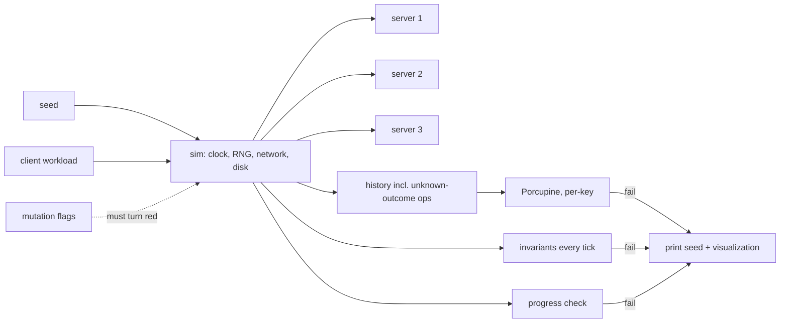

# Architecture: raft-kv

> Status: approved (2026-11-04), revised in verification rounds 1-2 (2026-11-04); details in `02-verification.md`

## Components
| Component | Package | Responsibility | Label | ADR |
|---|---|---|---|---|
| Raft core | `raft/` | Election (no-op on new term), replication, commit; `Tick` / `Step` / `Ready` / `Advance`; no I/O | **Deep** | 001 |
| KV state machine | `kv/` | Apply committed commands; sessions and dedup | **Deep** | 003, 006 |
| WAL | `wal/` | Single file (MVP), CRC-framed records, sync, torn-tail recovery, fail-stop on corruption | **Deep** | 007 |
| Server | `server/` | Single-threaded glue: Raft + KV + WAL over `FS`; **pending client requests and leadership-loss handling**; one event at a time. Used by simulator and real runtime | **Deep** | 001, 002, 006 |
| Simulator + chaos | `sim/`, `chaos/` | Virtual clock, seeded RNG, network/disk faults, crash/restart; workloads; Porcupine, invariants, progress, mutation suite | **Learn** | 002 |
| Node runtime | `node/` | Real ticker (10 ms, missed ticks coalesced); concurrent pieces: gRPC handlers → event-loop channel, pending-request wakeups, `context` shutdown, sending to peers. Unit-tested with `-race` | **Learn** | 001, 004 |
| gRPC transport + API | `transport/`, `proto/` | `raft.proto`, `kv.proto`; codegen with `buf` | **Learn** | 004, 006 |
| CLI client | `cmd/kvctl` | Session, retries with same seq, leader redirect | Commodity | 006 |
| LSM engine (M8) | `lsm/` | Memtable, SSTables, compaction, own WAL; `Storage` | **Deep** | 007 |
| Packaging | `deploy/`, `.github/` | Docker Compose (3 nodes), CI, smoke test | Commodity | 004 |

Deep areas: **Raft (core + KV semantics + server)** and **storage (WAL, later LSM)**.

## Data flow: a client write
```mermaid
sequenceDiagram
    participant C as kvctl / client
    participant L as Leader node
    participant F as Follower nodes
    C->>L: Put(key, val, clientID, seq) [gRPC]
    L->>L: raft.Step(propose); server records pending request
    L->>L: Ready: append entry to WAL, Sync
    L->>F: AppendEntries [gRPC]
    F->>F: WAL append + Sync
    F-->>L: success
    L->>L: commit advances; kv.Apply (dedup by clientID/seq)
    L-->>C: OK (or NOT_LEADER if leadership lost → client retries same seq)
```

## Testing structure

`node/` and `transport/` stay thin; messages round-trip through protobuf in the simulator; one real-process smoke test covers the rest.

## Repository structure
```
raft-kv/
├── cmd/raftkv/  cmd/kvctl/
├── raft/  kv/  wal/  server/      # Deep, deterministic
├── node/  transport/  proto/      # real runtime + gRPC
├── sim/  chaos/                   # simulator + checks
├── lsm/                           # M8
├── deploy/  .github/workflows/
└── docs/
```

## Decision checklist
Adapted for a distributed backend system. Added: determinism rules, fault model, timing, limits. Dropped: auth and hosting cost (non-goals).

| Category | Item | Decision | Reason | Source / ADR |
|---|---|---|---|---|
| Product | MVP, non-goals, criteria, angle | See vision (3 nodes, gRPC only) | Revised round 1 | `00-vision.md` |
| Technology | Language | **Go 1.27.3** (`go 1.27` in go.mod) | Installed, released | `go version` |
| Technology | Key libraries | grpc-go v1.85.0, protobuf-go v1.36.12, Porcupine v1.3.1 (pinned) | Licenses Apache-2.0 / BSD-3 / MIT, compatible with MIT | ADR-002, 004 |
| Technology | Codegen | `buf` 1.75.0 + `protoc-gen-go`, `protoc-gen-go-grpc` | `protoc` broken locally | ADR-004 |
| Technology | Storage | Own WAL; in-memory map (MVP); own LSM (M8) | Deep | ADR-007 |
| Architecture | Consensus core | Pure state machine | Determinism | ADR-001 |
| Architecture | Timing | Tick 10 ms, heartbeat 50 ms, election 300-600 ms | Raft §5.6 | ADR-001 |
| Architecture | API style / contract | gRPC; sessions; one in flight per client; error model | Linearizability | ADR-004, 006 |
| Architecture | Determinism rules | No `time.Now`, `go`, global rand, map-order iteration in `raft/ kv/ wal/ server/ sim/ chaos/`. Enforced by running each CI seed twice and comparing trace hashes; `forbidigo` bans `time.Now`/global rand | Reproducible seeds | ADR-001, 002 |
| Data | Persistent state | `raft.wal`: entries, HardState (term, vote, commit), truncations | Smallest correct MVP | ADR-007 |
| Data | Format / identity | WAL header: magic, version, cluster ID, node ID; little-endian; protobuf payloads; empty WAL needs `--bootstrap` | Detect foreign files; prevent unsafe reset | ADR-007 |
| Data | KV semantics | Missing key → `found=false`; delete missing → OK; empty value ≠ not-found | One model for proto, CLI, Porcupine | ADR-006 |
| Data | Limits | key ≤ 1 KiB, value ≤ 64 KiB, WAL record ≤ 1 MiB, AppendEntries ≤ 64 entries / 1 MiB, gRPC message ≤ 4 MiB | Bound memory, detect corruption, followers can catch up | ADR-001, 006, 007 |
| Quality | Tests | Unit; deterministic chaos (Porcupine + invariants + progress); mutation suite; `-race`; smoke test | Angle | ADR-002, 004 |
| Quality | Fault model | MVP: drop, delay, reorder, duplicate, partition, crash, lose unsynced writes, `Sync` latency. M7: + torn writes, bit flips | 2b → 2c | ADR-002 |
| Quality | Lint / format | `gofmt`, `golangci-lint` (incl. `forbidigo`) | Standard | minor |
| Quality | CI | Per push: lint, `-race` unit tests + 10 seeds, 100 seeds × 300 ops without race < 3 min. By MVP release (M6): smoke test, nightly 2000 seeds | Budget (measure in spikes) | ADR-002 |
| Quality | Coverage target | Not set: chaos + mutation suite measure correctness better | — | — |
| Reliability & security | Retries / idempotency | Same (clientID, seq) on retry; dedup; 500 ms deadline, jittered backoff | Exactly-once effect | ADR-006 |
| Reliability & security | Disk errors | Crash on write/sync error (exit 2); fail-stop on mid-log corruption (exit 3); torn tail truncated (residual risk documented) | No silent loss except the accepted torn-tail case | ADR-007 |
| Reliability & security | Auth / TLS | Not needed: non-goal. Nodes listen on the Compose network; host ports published on 127.0.0.1 | — | vision |
| Reliability & security | Config / secrets | Flags + env; static peer list; no secrets | Fixed membership | minor |
| Reliability & security | Dependency audit | `govulncheck` in CI | Cheap | minor |
| Operations | Deploy | Docker Compose, 3 nodes, named volumes; healthcheck = gRPC health `SERVING`; `restart: "no"`; `make reset` wipes all volumes (only allowed reset) | Local demo, no crash loops | ADR-006, 007 |
| Operations | Shutdown | SIGTERM → stop accepting, finish current `Ready`, close WAL | Clean restarts | minor |
| Operations | Logs / debugging | `log/slog` with node id, term, index; metrics later | Standard library | minor |
| Operations | Backups / cost | Not needed: local demo only | — | — |
| Operations | Performance | Not an MVP goal; M8 LSM amplification + latency percentiles | Correctness first | vision |
| Process | Repo layout | As above | Matches components | — |
| Process | Branches / commits | Trunk (`main`), Conventional Commits; user commits | User's choice | minor |
| Process | Versioning | Tags `v0.1.0` (MVP), `v0.2.0` (M7), `v0.3.0` (M8) | Simple | minor |
| Presentation | License / repo | MIT, public GitHub | Portfolio | minor |
| Presentation | README / demo | Diagram, demo GIF, Porcupine visualization, bug log with seeds | Angle | vision |
| Risks & assumptions | Risk register + spikes | See below | — | — |

## Risk register
| Risk | Likelihood | Impact | Mitigation |
|---|---|---|---|
| Schedule slip (beginner, holidays) | High | High | Bottom-up estimate, ordered cut list and Checkpoint A (end of M4: Raft + WAL + sim + Porcupine, no gRPC/Docker) in `03-plan.md`; re-baseline after spikes |
| Motivation / burnout over long scope | Medium | High | Demoable result at the end of each milestone; M7/M8 optional for "finished" |
| Simulator bug hides real bugs | Medium | High | Mutation suite; smoke test on real processes |
| Simulated FS diverges from real `fsync` | Medium | Medium | Accepted; stated in README; FS model follows ADR-007 rules |
| History recording errors → false red/green | Medium | High | Recording rules in ADR-002; hand-made histories in spike 2 |
| Unsafe node reset | Low | High | WAL identity header, `--bootstrap`, whole-cluster reset only |
| Beginner bugs in concurrent `node/` glue (not simulated) | Medium | Medium | Concurrency warm-up before `node/`; `-race` unit tests; smoke test |
| Porcupine slow on histories | Low | Medium | Per-key partitioning; ≤ 1000 ops per run |
| State-machine Raft style too hard | Medium | High | 40 h revisit trigger + fallback (ADR-001) |
| CI time / minutes | Low | Low | Budgets per push / nightly (ADR-002) |
| LSM never finished | Medium | Low | LSM is M8, after the MVP is shipped |

## Spikes (feed M1)
| # | Risk | Spike | Pass criterion |
|---|---|---|---|
| 1 | Simulator not deterministic; effort unknown | Toy 3-node ping protocol on `sim/` | Same seed → byte-identical trace, 1000 seeds; record hours spent and time per seed |
| 2 | Porcupine model / history recording | Per-key KV model; hand-made histories for each ADR-002 recording rule | Linearizable passes, non-linearizable fails, retries/unknown ops handled; time per 300-op check measured |
| 3 | `Sync` latency on Docker Desktop named volume | Write + Sync loop, 10k iterations | Report p50/p99; p99 < 20 ms (else revisit tick/heartbeat). Does **not** test durability |
| 4 | Go toolchain setup | Remove old `/usr/local/go` 1.24, add `~/go/bin` to PATH, install `golangci-lint`, `govulncheck`; `buf generate` one message | All tools run; generated code compiles |
